# Golle

**A free personal database for your Mac.** Make tables with your own fields, then keep records of
anything: record collections, reading lists, inventories, recipes, contacts.

Each database is one `.golledb` file you can save, copy, back up and send. Local only: no accounts,
no sync, no telemetry. The network is used only when you look up a barcode or find a place on the map,
and that can be turned off in Settings.

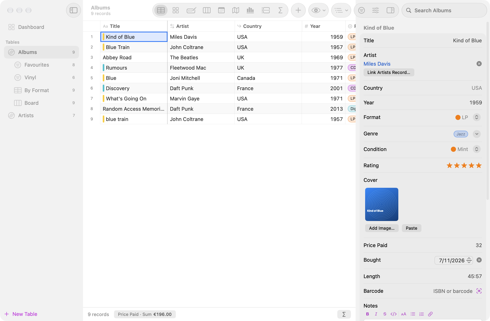

## Views

The same records, seen nine ways (View ▸ as Table ⌘1, Gallery ⌘2, Form ⌘3, Board ⌘4, Calendar ⌘5,
Map ⌘6, Chart ⌘7, Timeline ⌘8, Summary ⌘9). Every view keeps its own filter, sort, grouping and columns, and can be saved by
name in the sidebar.

| | |
|---|---|
| 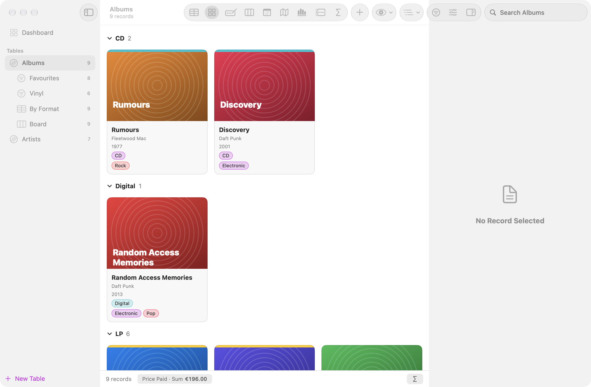 | 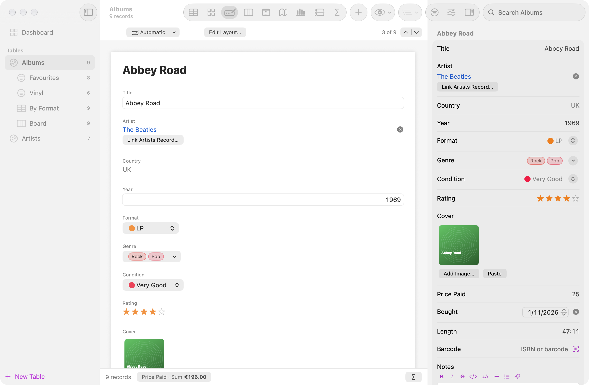 |
| **Gallery** — cards with the first image as a cover, grouped by up to two fields. | **Form** — one record at a time on a layout you design by dragging and resizing fields. |
| 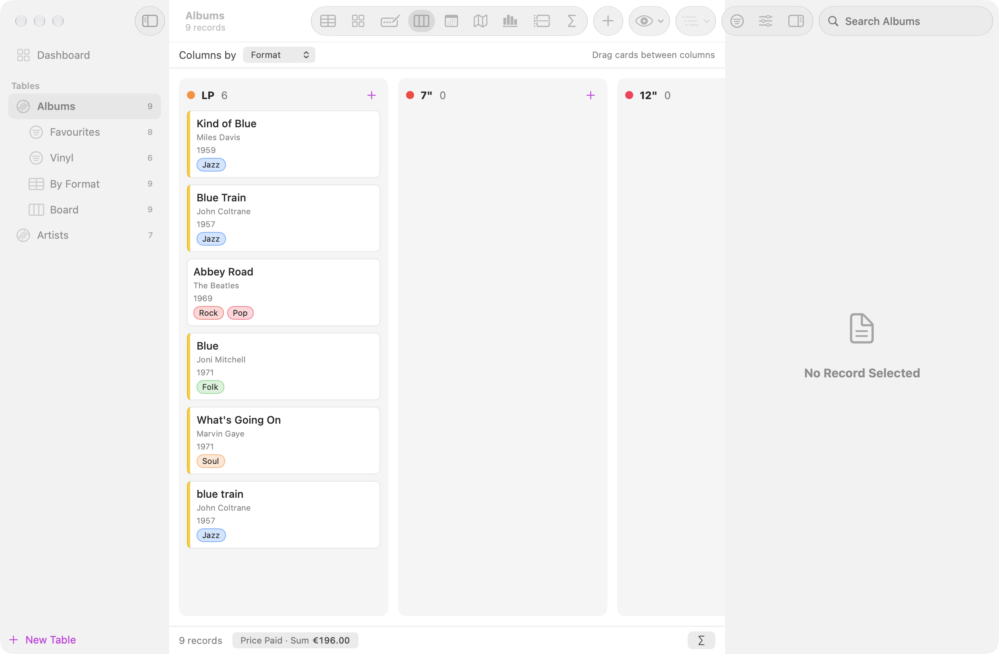 | 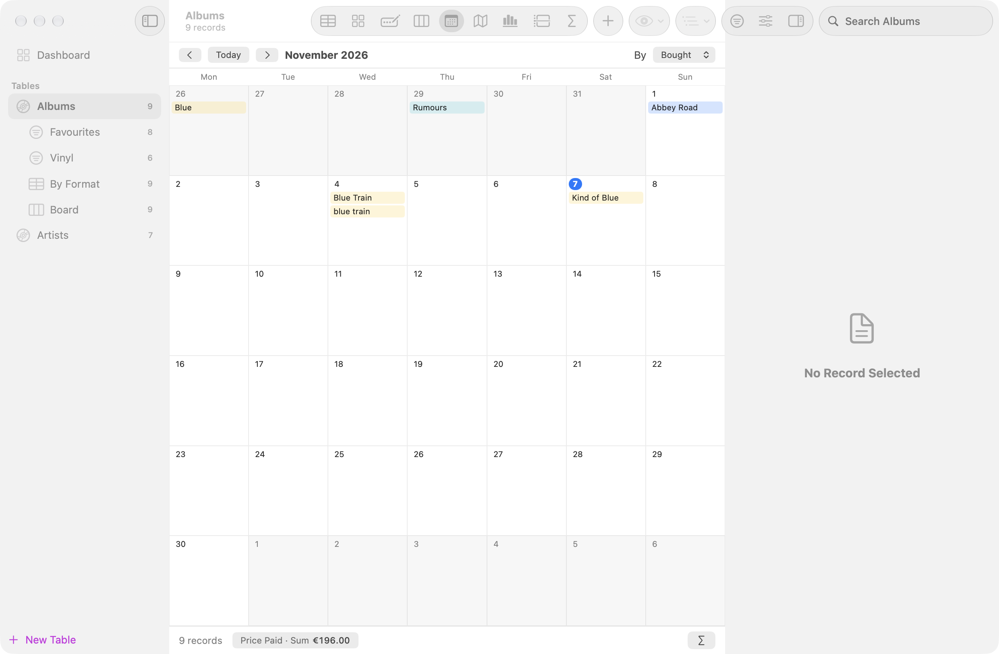 |
| **Board** — a column per option of a choice field; drag cards between columns. | **Calendar** — records on a month grid by a date field; drag them to another day. |
| 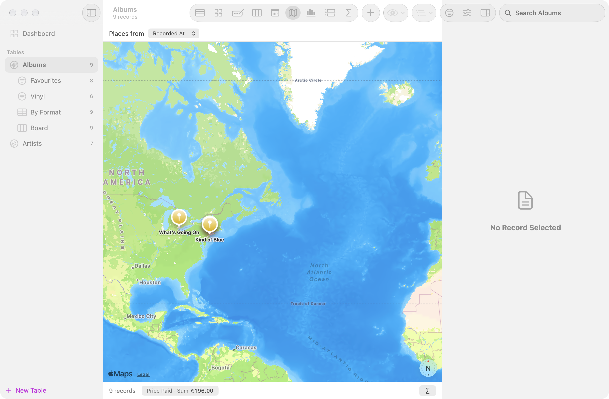 | 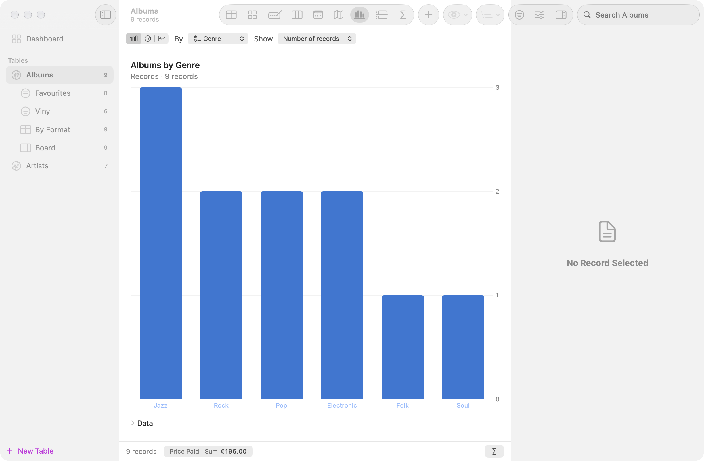 |
| **Map** — every record with a location as a pin. | **Chart** — bars, a donut or a line over time, counted, summed or averaged. |
| 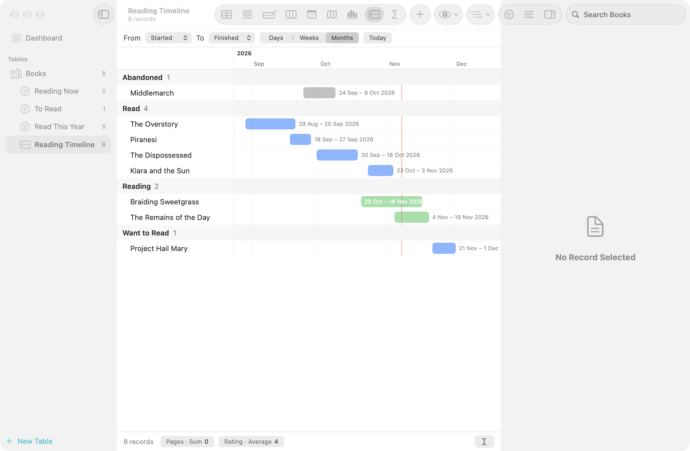 | 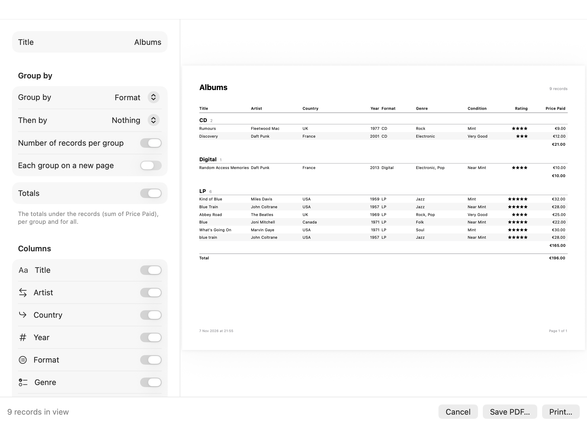 |
| **Timeline** — bars from a start to an end date, by day, week or month, grouped like the table; drag a bar to move it, its edge to change the end. | **Reports** (File ▸ Print Report, ⌥⌘P) — grouped printouts with a header per group, counts and totals, as PDF or on paper. |
| 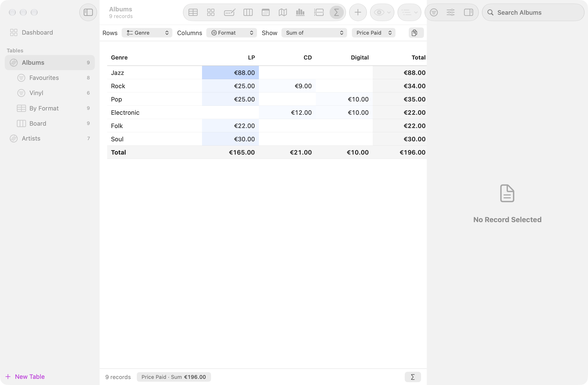 | |
| **Summary** — records counted, or a number field added up, by one field along the rows and another along the columns, with totals; dates by day to year, numbers by 10 (years per decade). Click a cell to select its records; copy the table for a spreadsheet. | |

And a **dashboard** that puts charts and numbers from any table side by side:

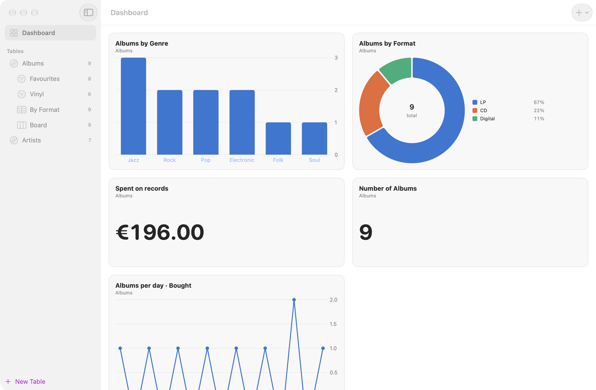

## What's in it

**Fields** (Database ▸ Edit Fields, ⇧⌘E)
- Text, long text, number, date (optionally with the time), checkbox, choice, multiple choice (as coloured tags), rating, web link, checklist
- Duration ("45:12", "1:02:30", "1h 30m"), which adds up in totals, rollups and charts
- Email and phone, with a button to write or call; barcode and ISBN, checked for typing mistakes and scannable with the camera
- Progress as a bar (0–100%), and colour as a swatch
- Rollups: count or add up linked records, also through "Linked From" (the number of albums of an artist, the total length of an album's tracks)
- Formatted long text — bold, italic, strike, code, headings, lists, links — saved as readable Markdown
- Image and file fields: drop files, images from a browser or Photos, or paste; Quick Look, open, save a copy
- Location: an address or place, found on the map
- Automatic fields: auto number (with a prefix, like INV-42), created date, modified date
- Number formats: currency, percent, fixed decimals, units ("12 kg"); default values for new records
- Linked records: point at records in another table, edit the links right in the table. The other side
  shows them as a small table in the record's form: an artist's albums, a recipe's ingredients, edited in
  place, with "+" to add one that is already linked and the totals underneath
- Lookups: show a field of the linked records (an album's artist country), sorted, filtered and totalled like that field
- Formulas: `{Price} * {Quantity}`, `IF({Rating} >= 4, "Favourite", "")`, `SUM(LOOKUP({Tracks}, "Length"))`,
  `SWITCH({Format}, "LP", "Vinyl", "CD", "Disc", "Other")`, `FORMATDATE({Bought}, "d MMMM yyyy")`, and text
  functions like `MID`, `FIND` and `SUBSTITUTE`
- Changing a field's type converts its values where it can; renaming one updates the formulas that use it
- Rules: make a field required or unique, keep numbers between a minimum and a maximum, dates out of the
  future or the past, and text to a pattern (digits only, a Dutch postcode, an email address, or your own);
  records that break a rule are marked in the table and the form, and counted under the records. Nothing
  is refused.

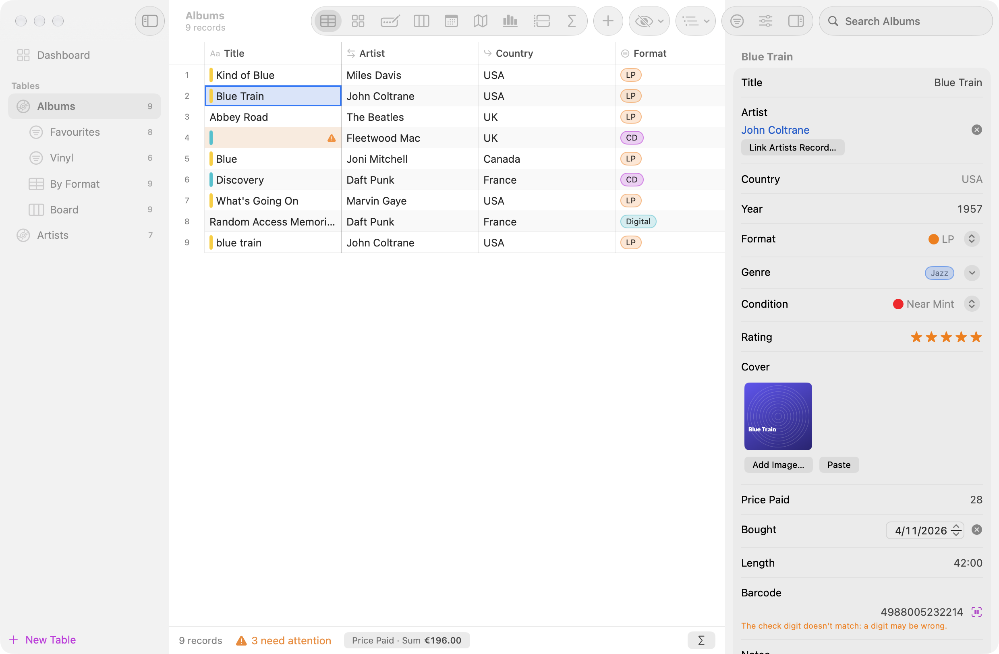

**Working with records**
- The table works like a spreadsheet: click a cell, move with the arrow keys, ⇧ or drag to select a block,
  type to edit (Return saves and goes down, Tab goes right, Escape cancels; Return in the last row adds a
  record). Row numbers select whole rows, the first column stays put while scrolling sideways, and columns
  are resized and moved by dragging their headers, per view
- Copy, cut and paste blocks of cells with spreadsheets: paste a block from Numbers or Excel and it fills the
  cells from the selected one, adding records as needed (a first row of field names puts each column under
  its field); one value pasted over a block fills it. Delete clears the cells, Fill Down (⇧⌘D) copies the
  top row down
- Select several records and change a field for all of them at once in the inspector
- Find and Replace (⌥⌘F) in one text field or all of them, over the records in view, with a preview; one undo step
- Every change is kept in the record's history (the last 100), with a button to restore an old value
- Colour rules (⇧⌘K): records matching a rule get its colour in every view
- Find duplicates and merge them; duplicate and reorder tables
- Undo and redo for everything, autosave, and macOS Versions (File ▸ Revert To ▸ Browse All Versions)

**Finding**
- Search across every field, filters with rules per field type (⌥⌘L), saved views (⌥⌘S)
- Group by up to two fields, with collapsible groups and totals per group
- Totals under the records: sum, average, minimum, maximum, filled, empty, checked, unique

**In and out**
- Start blank or from a template (⌥⌘N): record collection, reading list, movies, home inventory,
  contacts, recipes, collection
- Import CSV or Excel (⇧⌘I), guessing the field types; export CSV, Excel, JSON or PDF
- Scan a barcode (⇧⌘B) with the Mac's camera or an iPhone (Continuity Camera): books are found by
  ISBN at Open Library, albums by barcode at MusicBrainz, and fill in the record, cover included
- Print the list or records as forms (⌘P), or labels and index cards (⇧⌘P)

**Privacy**
- A password lock encrypts the database and its files on disk (AES-256), with optional Touch ID
- Turn online lookups off in Settings and Golle sends nothing anywhere

**Settings** (⌘,)
- Settings that travel with a database live in it: its colour and icon (Database ▸ Appearance & Password),
  fields, views and rules
- Golle's own Settings are for you and this Mac: light, dark or system appearance; what opens at launch
  (the Welcome window, the databases that were open, or nothing); the currency for new number fields;
  how many changes the record history keeps (or none); the CSV separator (comma, semicolon or tab) and
  the UTF-8 mark for Excel

## Download

Grab the latest zip from [**Releases**](https://github.com/iappyx/Golle/releases/latest). For Macs with
Apple Silicon, macOS 27 or newer.

1. Unzip it and drag **Golle.app** to your **Applications** folder.
2. Open it. macOS will say it cannot verify the developer — Golle is signed, but not notarized by
   Apple, which needs a paid developer account. Click **Done**.
3. Open **System Settings → Privacy & Security**, scroll down to **Security**, and click
   **Open Anyway** next to Golle. Confirm once; it opens normally from then on.

The first time you scan a barcode, macOS asks whether Golle may use the camera.

## Build & run

No Xcode needed; the Command Line Tools for macOS 27 are enough.

```sh
scripts/build-app.sh release --run   # build build/Golle.app and open it; VERSION=1.2.3 sets the version
scripts/test.sh                      # unit tests, run through the app binary (Golle --test)
scripts/screenshots.sh               # re-render docs/screenshots from the real views
scripts/make-signing-identity.sh     # once, optional: a stable local signing identity (see below)
scripts/make-icon.sh                 # redraws Resources/AppIcon.icns
```

The release workflow runs the same `build-app.sh`, so a local build and a released one are assembled
the same way. Without `VERSION` the app takes its version from `Resources/Info.plist`.

> **Tip:** ad-hoc signatures change on every build, so the Keychain treats each build as a different
> app and asks again before Touch ID can unlock a locked database. The self-signed
> "Golle Local Signing" identity from `scripts/make-signing-identity.sh` keeps the signature stable.

`scripts/release.sh` makes a notarized build instead, for when there is a paid Apple Developer account.

## Releases

Tag a version and GitHub builds, tests and publishes it: push a tag (`git tag v1.0.0 && git push
origin v1.0.0`), or on GitHub choose **Releases → Draft a new release**, type a new tag like `v1.0.0`
and publish; the workflow then adds the zip to that release.

`.github/workflows/release.yml` runs on GitHub's macOS 27 runner (`xcode-27`), builds the app with that
version, runs the tests, checks that no build paths ended up in the binary, and attaches
`Golle-1.0.0.zip` to a new release. Run the workflow by hand (Actions → Release → Run workflow) for a
test zip that is published nowhere. `ci.yml` builds and tests every push and pull request.

## Layout

```
Sources/Golle/
  App/        app entry, menus, the document (saving, undo, attachments, lock)
  Model/      database, values, views and filters, formulas, Markdown, charts, layouts, templates
  Store/      SQLite, the file format, CSV/JSON/Excel, encryption, barcode lookups
  UI/         window, table, gallery, form, board, calendar, map, charts, editors, printing, About
  Testing/    test runner and tests (--test), screenshots (--screenshots)
Resources/    Info.plist and the app icon
docs/screenshots/   README images, rendered from the real views (scripts/screenshots.sh)
scripts/      build, test, screenshots, icon, signing and release
.github/workflows/  CI on every push; tag a vX.Y.Z and GitHub builds and publishes the release
```

© 2026 iappyx · MIT License, see [LICENSE](LICENSE).
